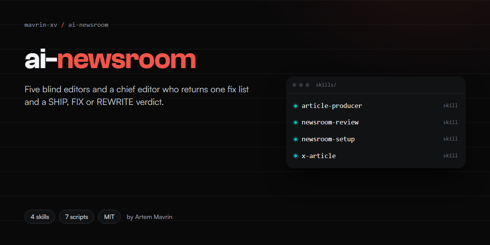

# ai-newsroom

**An editorial desk for your AI agent. Five editors who cannot see each other review a draft for format, structure, voice, reader fit and claims. A chief editor merges their notes into one fix list and a SHIP, FIX or REWRITE verdict. Two writing skills sit on top: one for blog articles, one for X long-form. Every rule comes from one brand profile you fill once.**

An AI draft usually reads fine, and that is the problem. It takes a careful reader to spot the figure with no source, the title that names a topic instead of an outcome, the sentence the author would never say, or the slug nobody checked.

[](LICENSE)


```bash
git clone https://github.com/mavrin-xv/ai-newsroom && cd ai-newsroom
./install.sh                 # or: ./install.sh --project
```

<!-- install-notes:start -->
Other ways in: as a Claude Code plugin, run `/plugin marketplace add mavrin-xv/ai-newsroom` and then `/plugin install ai-newsroom@ai-newsroom`. For Codex or another agent that reads `SKILL.md`, copy the folders under `skills/` into its skills directory. On Windows, run `install.sh` from Git Bash or WSL and type `py -3` where these docs say `python3`.
<!-- install-notes:end -->

Then tell your agent: `set up my brand for the newsroom`, then `write a guide on <topic>` or `run the editors on draft.md`.

---

## What it solves

| Pain | What the pack does |
|---|---|
| One reviewer, one blind spot | Five editors in separate contexts, each with its own lane and only the profile sections that lane needs; none sees another's verdict |
| Five opinions, no decision | `review_run.py merge` dedupes findings across editors, checks every quoted line is really in the draft, proposes a verdict; the chief editor resolves conflicts by a fixed order of precedence |
| Figures nobody can trace | `claims_scan.py` lists every number, superlative and absolute and matches it against the Proof table and `sources.md`; the claims editor audits the rest |
| "It reads fine" but breaks the house rules | `structure_lint.py` measures title, description, summary block, H2 count, required sections, hook, paragraph length, word band, CTA count and banned words from the profile |
| The author's voice drifts into generic AI | Voice profiles built from 5 or more real samples; the voice editor grades against them, not against taste |
| Review rounds that never end | Each round is merged against the last (`--prev`): resolved, still open, new; a minor ledger that never re-raises; a round cap |
| Guessed slugs and cut-off descriptions | `link_check.py` checks links against an allowed list; `seo_fields.py` measures title, description, slug and variants |
| The blog post pasted into X | `x-article` picks one of five formats by intent and `x_article_check.py` checks title length, 5:2 cover, paragraph length, links per paragraph and CTA count |

## What's inside

| Skill | What it does | What to say |
|---|---|---|
| `newsroom-setup` | Interview plus your existing material into `brand-profile.md`; voice profiles from samples; inferred lines marked for you to confirm | "set up my brand", "add an author voice" |
| `newsroom-review` | Lints, blind briefs, five parallel editors, merge, chief editor, loop until SHIP or round 5 | "review this draft", "is this ready", "run the editors" |
| `article-producer` | Brief, sources, draft, lint, the review loop, then the publish package: fields, links, alt text, export | "write a guide on", "turn these notes into an article" |
| `x-article` | Five formats, seven levers, a source ladder, a six-part skeleton, the measurable checks | "write an X article", "turn this post into X long-form" |

## Quick start

Every script runs offline on Northwind Ledger, an invented bookkeeping company. `draft-v1.md` is flawed on purpose.

```bash
python3 skills/newsroom-review/scripts/structure_lint.py examples/northwind-ledger/draft-v1.md \
  --profile examples/northwind-ledger/brand-profile.md --format guide
```

```
structure_lint: draft-v1.md (format guide)
| Item | Result | Line | Detail |
|---|---|---|---|
| title | FAIL | 1 | 81 chars (max 70); banned opener |
| description | FAIL | 1 | 169 chars (max 155) |
| summary block | PASS | 10 | 4 bullets (want 3-5) |
| headings | FAIL | 17 | 6 H2 (max 6, summary block not counted); banned: line 17 'Introduction', line 49 'Conclusion' |
| template | FAIL | - | missing: When this does not apply |
| hook | FAIL | 8 | opens with 'Month-end close is the' |
| code and media | FAIL | 35 | code without language at [35] |
| paragraphs | FAIL | 19 | line 19: 9 sentences (max 4) |
| length | FAIL | - | 437 words (band 700-1600) |
| close | FAIL | 49 | last H2 'Conclusion' |
| cta count | PASS | - | 1 links to the CTA url (want 1-2) |
| punctuation and padding | FAIL | 19 | '!' at lines [19]; padding: Additionally (line 19), It is worth noting (line 19) |
| banned words | FAIL | - | found: seamless, best-in-class |

11 FAIL, 2 PASS
```

The same draft after three review rounds (`draft-v3.md`) gives `0 FAIL, 13 PASS`, and `claims_scan.py` goes from `9 claims, 7 not sourced` to `5 claims, 0 not sourced`. Every round is in the folder: `run-1/` to `run-3/` hold the briefs, the five verdicts, `merged.md` and the chief editor's `review.md`.

## How it works

```
 brand-profile.md ──┐
 draft.md ──────────┤
                    ▼
        structure_lint.py + claims_scan.py      (measure, do not judge)
                    │
        review_run.py packet                    (one brief per editor, only its sections)
                    │
   ┌────────┬───────┼────────┬─────────┐
 format  structure voice    icp      claims     (parallel, blind to each other)
   └────────┴───────┼────────┴─────────┘
        review_run.py merge --prev              (quotes checked, deduped, verdict proposed)
                    │
              chief editor                      (conflicts resolved, one fix list)
                    │
      SHIP ──► publish package    FIX ──► apply all, next round    REWRITE ──► new draft
```

The scripts do the counting, so the editors spend their attention on judgement. The chief editor may move the proposed verdict one step and must say why.

## Configure

Everything brand-specific lives in `brand-profile.md` (template in `templates/`). Lines of the form `- key: value` are read by the scripts.

| Setting | Where | Default |
|---|---|---|
| Word band, max H2, summary block, required sections | `## Formats`, one `###` block per format | 800-2000 words, 6 H2 (without a profile) |
| Title and description length, sentences per paragraph | `## Channels` | 70, 155, 4 |
| CTA url and how many times per article | `## CTA` (`url`, `max`) | none, 2 |
| Banned words | `## Banned` | none |
| Allowed links | `## Links` | none |
| Recommended findings that still allow SHIP | `review_run.py merge --recommended-limit` | under 5 |
| Blocking findings that force REWRITE | `review_run.py merge --rewrite-at` | 3 |
| Round cap | `review_run.py merge --max-rounds` | 5 |

## Honest limits

- The example ran three real rounds and ended at FIX, not SHIP. Blocking items fell from 14 to 0, but each round the editors raised about a dozen new recommended items, above the limit of 5. Either relax `--recommended-limit` for your team or expect the round cap to be what ends the loop.
- Editors follow the profile's prose, not the scripts. When a rule lived only in a script (the summary block does not count as an H2), the editors counted it anyway until the sentence went into the profile.
- `claims_scan.py` is a pattern matcher. It flags some instructions as superlatives and misses claims phrased without a number. The claims editor is the real audit.
- Nothing here checks facts against the world. A figure is "sourced" when it has a row; whether the row is true is yours to verify.
- Tested with Claude Code subagents on Windows. Codex and other agents, and macOS and Linux, are not tested.
- X platform facts were checked in 2026-11 and will drift.

## Credits

- Based on / inspired by https://github.com/obra/superpowers (MIT): fresh-context subagents per task, review before you trust, verification before claiming done
- Based on / inspired by https://github.com/anthropics/skills (Apache-2.0), doc-coauthoring: reader testing in a fresh context, one section at a time
- Based on / inspired by https://github.com/coreyhaines31/marketingskills (MIT): a product context file every skill reads, copy-editing sweeps by lane
- Based on / inspired by https://github.com/wshobson/agents (MIT) and https://github.com/VoltAgent/awesome-claude-code-subagents (MIT): single-lane reviewer agents with fixed output contracts
- Based on / inspired by Cornell University Marketing and Communications, content accuracy checklist: https://help.marcom.business.cornell.edu/review/content-accuracy (checklist idea; no text copied)
- X Help Center, Articles: https://help.x.com/en/using-x/articles (platform facts restated)
- Format and lever ideas drawn from public X long-form guides by Typefully, OpenTweet and PostEverywhere (ideas only; no text copied)

## Contributing

See [CONTRIBUTING.md](CONTRIBUTING.md). Notes for coding agents are in [AGENTS.md](AGENTS.md).

<!-- author:start -->
## Author

Built and maintained by [Artem Mavrin](https://github.com/mavrin-xv). This repo is one of a set of agent skill packs for marketing and operations work. Each one installs on its own; the full list is in [agent-skill-packs](https://github.com/mavrin-xv/agent-skill-packs). If a pack saved you an afternoon, a star helps other people find it.
<!-- author:end -->

## License

MIT. See [LICENSE](LICENSE).
